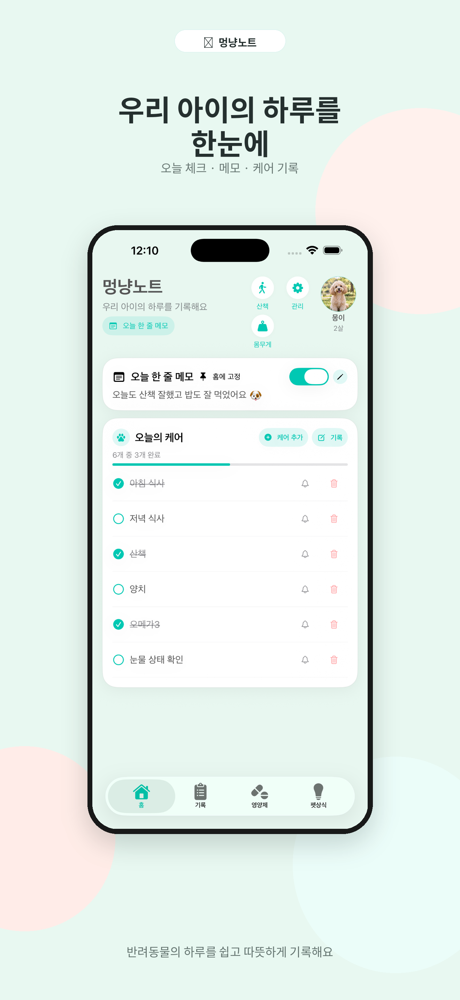
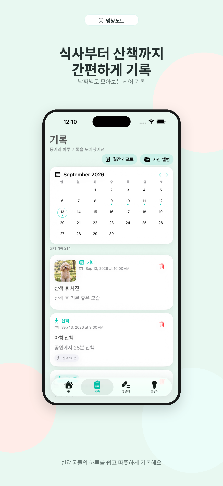
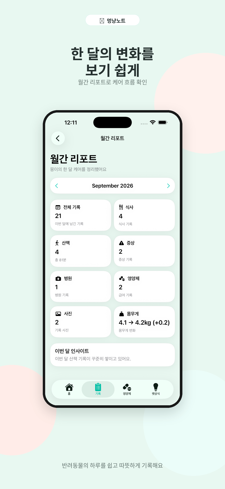
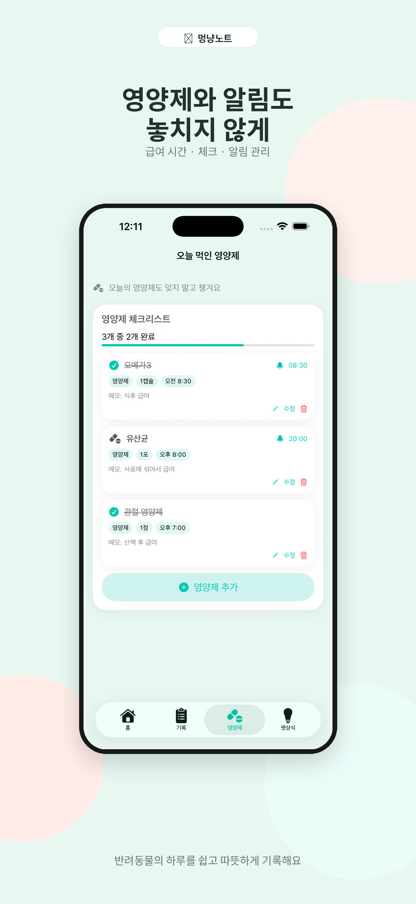
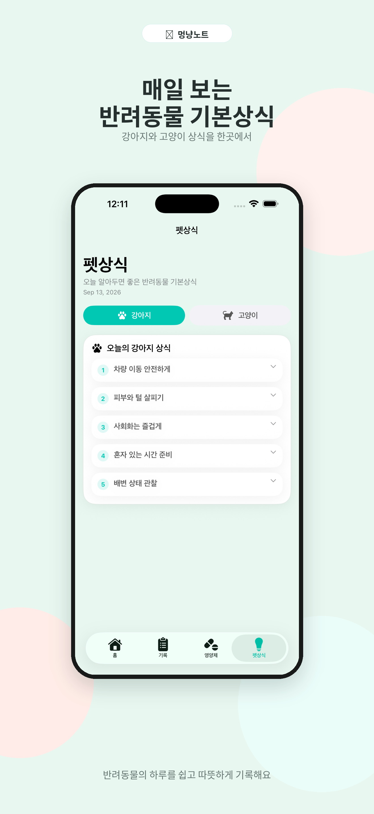

# 멍냥노트 프로젝트 상세

## 프로젝트 소개

멍냥노트는 보호자가 반려동물의 생활을 기록하고 매일의 케어를 확인하는 iOS 앱입니다. SwiftUI로 작성했으며 현재는 **TestFlight 준비 중**입니다.

사용 흐름은 반려동물 선택 → 오늘의 케어 확인 → 생활 기록 작성 → 사진과 월간 리포트로 돌아보기로 이어집니다. 서버 운영이나 회원가입 없이 기기에서 바로 사용할 수 있도록 로컬 저장을 사용합니다.

## 화면 미리보기

실제 앱 화면을 담은 사용자 제작 홍보 이미지입니다.

| 홈 | 기록 | 월간 리포트 |
| --- | --- | --- |
|  |  |  |

| 영양제 | 펫상식 |
| --- | --- |
|  |  |

이미지 설명과 파일 목록은 [스크린샷 안내](../screenshots/README.md)에 정리했습니다.

## 화면과 구현 연결

| 구현 파일 | 담당 기능 |
| --- | --- |
| `DangDangNoteApp.swift`, `ContentView.swift` | 앱 진입점, 공용 상태, 온보딩과 4개 탭 |
| `HomeView.swift` | 오늘의 케어, 공용 메모, 산책 타이머, 케어 알림 |
| `PetProfileStore.swift`, `PetManagementView.swift`, `DogProfileView.swift` | 여러 마리 프로필과 선택 상태, 프로필 편집 |
| `AddRecordView.swift`, `HistoryView.swift` | 유형별 기록 입력, 저장, 날짜별 조회와 삭제 |
| `SupplementCheckView.swift` | 영양제 편집, 완료 체크, 반복 알림 |
| `WeightRecordView.swift` | 체중 기록과 케어 기록 연동 |
| `PhotoAlbumView.swift` | 기록 첨부 사진 모아보기 |
| `MonthlyReportView.swift` | 선택한 반려동물과 월 기준의 집계 |
| `PetTipsView.swift` | 강아지·고양이 상식 콘텐츠 |
| `ManagementView.swift`, `DataManagementView.swift` | 관리 메뉴, 테마, 백업·복원·초기화 |

파일은 저장소의 `DangDangNote/`에 있습니다. 화면 내부에 모델과 저장 헬퍼가 함께 정의된 부분도 있습니다.

## 상태 관리

`PetProfileStore`는 ObservableObject와 Published로 프로필 목록과 선택한 프로필 ID를 관리합니다. 화면은 EnvironmentObject로 이를 참조합니다. `ThemeManager`가 공통 테마를 제공하고, 개별 화면의 입력값과 표시 상태는 State로 관리합니다. 각 탭은 NavigationStack을 사용합니다.

## 데이터 모델과 저장

주요 모델은 `PetProfile`, `CareItem`, `CareRecord`, `SupplementItem`, `WeightRecord`입니다. Codable을 이용해 배열을 JSON Data로 직렬화한 뒤 UserDefaults에 저장합니다.

| 저장 키 | 내용 |
| --- | --- |
| `petProfiles`, `selectedPetProfileID` | 프로필 목록, 선택 상태 |
| `careItems`, `careRecords` | 체크 항목, 생활 기록 |
| `supplementItems`, `weightRecords` | 영양제 목록, 체중 기록 |
| `todayMemo`, `todayMemoPinned` | 공용 메모와 고정 여부 |
| `selectedTheme` | 앱 테마 |

케어·생활·영양제·체중 데이터의 `petID`로 반려동물을 구분합니다. 기존에 저장된 ID 없는 데이터는 첫 번째 기본 프로필로 조회하는 호환 처리가 있습니다. 모든 설정이 반려동물별로 독립된 것은 아니며 메모와 테마는 공용입니다.

프로필 사진과 기록 사진은 PhotosPicker로 선택하고 UIKit으로 축소·JPEG 변환합니다. 앨범은 별도 사진 저장소가 아니라 CareRecord의 이미지 데이터를 조회하는 화면입니다. 기록 사진은 긴 변을 최대 900으로 줄이고 JPEG 품질 0.7로 저장합니다.

## 케어와 알림

오늘의 케어와 영양제 완료 상태는 날짜 변경을 확인할 때 초기화합니다. 백그라운드에서 자정에 항상 실행되는 작업으로 설명하지 않습니다. UserNotifications 권한을 요청한 뒤 알림을 등록하며, 영양제 알림은 시간·분 기준의 반복 알림입니다. 항목 삭제나 알림 해제 시 예약 알림을 취소하는 처리가 있습니다.

## 기록과 월간 리포트

식사에는 식사 상태, 산책에는 시간, 증상에는 선택한 증상 등 유형별 필드를 저장합니다. 체중 추가 시에는 케어 기록에도 체중 정보를 남깁니다.

월간 리포트는 선택한 월과 반려동물에 맞는 데이터를 집계합니다. 유형별 건수, 산책 시간 합계, 사진 수, 월내 첫 체중과 마지막 체중의 차이를 보여줍니다. 안내 문구는 기록 조건에 따른 규칙 기반 분기이며 AI 분석이나 건강 진단 기능은 아닙니다. 펫상식 역시 앱 소스에 포함된 콘텐츠입니다.

## 백업과 현재 범위

데이터 관리 화면은 JSON 백업 파일 생성·공유와 파일 선택을 통한 복원을 제공합니다. 일부 값이 없는 백업을 복원할 때는 현재 값을 보존하며, 복원 후에는 앱 재실행을 안내합니다. 자동 서버 백업이나 계정 간 동기화는 구현되어 있지 않습니다.

UserDefaults에 배열과 사진을 함께 저장하므로 데이터가 많아질 때의 크기와 성능은 별도 검증이 필요합니다. 테스트 타깃의 예제 테스트에는 기능 기대값 검증이 아직 없습니다. 이번 정리는 소스 확인을 통한 문서 작업이며, 실기기 알림·배포·대용량 성능 검증을 완료했다는 의미가 아닙니다.

실행 환경과 빌드 명령은 [README](../README.md), 코드에서 확인되는 문제 대응은 [troubleshooting](troubleshooting.md)에 정리했습니다.
